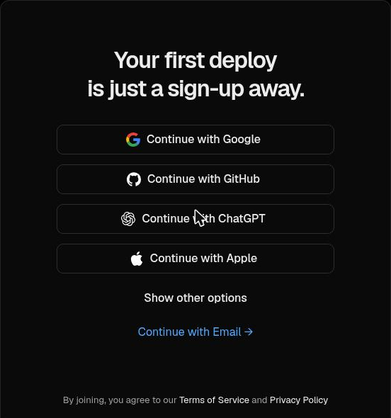
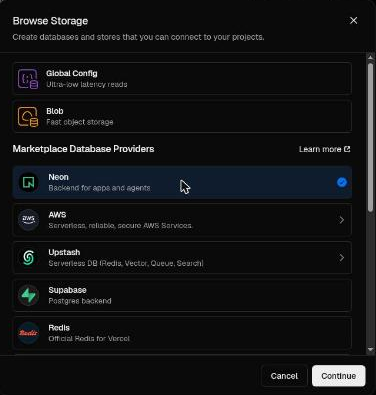
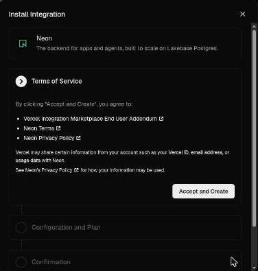
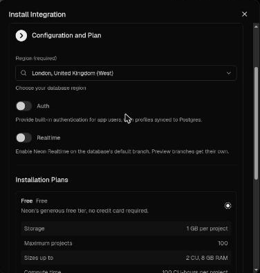
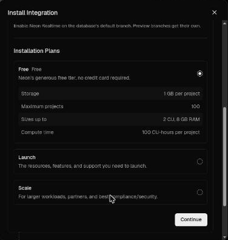
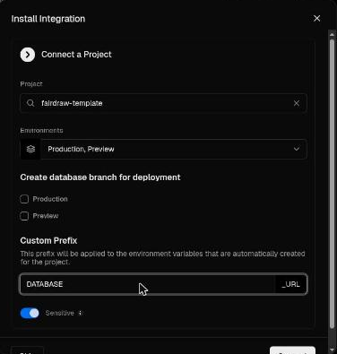
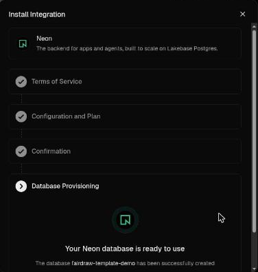

# Putting the site on Vercel and Neon (no server)

This is the quickest way to get the template online: [Vercel](https://vercel.com) runs the site and
[Neon](https://neon.tech) runs the PostgreSQL database. Both have free plans, so it suits a demo, a brand trial or a
private test with friends.

**Read this first.**

- Vercel's free Hobby plan is for personal, non-commercial use. A site that sells tickets needs a paid Vercel plan,
  or a server as in [start-here.md](start-here.md), which is what this template is mainly built for.
- Neon's free plan has a monthly allowance of database compute time (100 CU-hours per project when this guide was
  written), and the database sleeps after 5 minutes without use. Step 7 keeps it asleep between events so the
  allowance lasts the month.
- On Vercel there is no worker process. The scheduled work (closing competitions, making draws, settling payments)
  runs when something calls `POST /api/cron/tick`. Step 7 sets that up.
- Screens change. If yours look different, look for the same words.

## 1. Sign up to Vercel

Go to [vercel.com/signup](https://vercel.com/signup) and choose **Continue with GitHub** (easiest, because your copy
of the template is on GitHub) or **Continue with Email**. Pick the Hobby plan.



## 2. Create the project

In Vercel choose **Add New**, then **Project**, and import your copy of the repository. Vercel recognises Next.js;
leave the build settings as they are. The first build fails until step 4 is done, which is expected.

If you prefer the command line, install Node.js 24 and pnpm on your computer, then in your copy of the repository:

```sh
pnpm dlx vercel@latest login
pnpm dlx vercel@latest link
```

## 3. Add the database

In the project, open **Storage**, choose **Neon** and press **Continue**.



Read and accept the terms (Vercel and Neon's own).



Choose the region **London, United Kingdom (West)** so players' data stays in the UK, and leave **Auth** and
**Realtime** off: the template has its own accounts and does not need them.



Choose the **Free** plan (no card needed) and continue.



Connect the database to your project for **Production** and **Preview**, and set the **Custom Prefix** to
`DATABASE`. Vercel then creates `DATABASE_URL` and `DATABASE_URL_UNPOOLED` for you. The site uses the unpooled one
when it is there, because the scheduled work's lock does not work through Neon's connection pooler.





## 4. Settings

Open **Settings**, then **Environment Variables**, and add these for **Production**. Generate each secret on your own
computer with `openssl rand -hex 32` and paste it straight into Vercel. Never paste secrets into a chat with an AI
assistant.

| Name | Value |
| --- | --- |
| `APP_URL` | Your site's address, for example `https://competitions.example.co.uk` |
| `APP_SECRET`, `ENTRY_CODE_SECRET`, `CRON_SECRET` | Three different secrets from `openssl rand -hex 32` |
| `SITE_NAME`, `OPERATOR_LEGAL_NAME`, `OPERATOR_COMPANY_NUMBER`, `OPERATOR_REGISTERED_ADDRESS`, `OPERATOR_ICO_NUMBER`, `CONTACT_EMAIL`, `PRIVACY_EMAIL`, `POSTAL_ENTRY_ADDRESS`, `PAYMENT_PROCESSOR_NAME` | Your business details, as in [.env.example](../.env.example) |
| `PAYMENT_PROVIDER` | `test` until you launch, then `stripe` with `STRIPE_SECRET_KEY` and `STRIPE_WEBHOOK_SECRET` ([payments.md](payments.md)) |
| `TEST_PAYMENTS_ALLOWED_IN_PRODUCTION` | `true` only while `PAYMENT_PROVIDER` is `test` |
| `DATABASE_POOL_MAX` | `2` (each Vercel instance opens its own connections) |
| `SMTP_HOST`, `SMTP_PORT`, `SMTP_USER`, `SMTP_PASSWORD`, `MAIL_FROM` | Your email provider. Without one, new players cannot confirm their email address. |
| `DEMO_MODE` | `true` only for a public demo of the template (see "A public demo" below) |

From the command line, `printf '%s' "$(openssl rand -hex 32)" | pnpm dlx vercel@latest env add APP_SECRET production`
adds a secret without it ever appearing on screen.

## 5. Your domain

In **Settings**, **Domains**, add your domain or a subdomain such as `competitions.example.co.uk`. Vercel shows the
DNS record to add at your DNS provider (usually a `CNAME` to `cname.vercel-dns.com`). If your DNS is on Cloudflare,
leave the record "DNS only" (grey cloud) so Vercel can issue the certificate. Set `APP_URL` to the same address.

## 6. Create the tables, then deploy

Copy the production settings to a private file on your computer, create the tables, and delete the file:

```sh
pnpm dlx vercel@latest env pull .env.production.local --environment=production
set -a; . ./.env.production.local; set +a
pnpm db:migrate
rm .env.production.local
```

Then deploy: push to GitHub (if you imported the repository) or run `pnpm dlx vercel@latest deploy --prod`. Run the
migration step again whenever an update adds a file to `drizzle/`, before deploying that update.

## 7. The scheduled work

Something has to call `POST /api/cron/tick` with `Authorization: Bearer <CRON_SECRET>`. Each call answers with
`next_due_at`, the time it next has something to do. There are two ways.

**Recommended on a free database: [scripts/tick.sh](../scripts/tick.sh)** on any always-on Linux machine (a home
server or a Raspberry Pi is enough). Run from cron every 5 minutes, it only calls the site when a close, a draw or an
unpaid order is due, and every 6 hours anyway, so the database sleeps the rest of the time. The comments at the top
of the script show the two lines of settings and the cron line.

**GitHub Actions:** [.github/workflows/tick.yml](../.github/workflows/tick.yml) calls every 5 minutes once you add
the repository variable `TICK_URL` (your site's address) and the secret `CRON_SECRET`. It is simple, but it keeps a
free database awake all month, GitHub sometimes runs scheduled jobs late, and on a private repository the runs count
against your Actions minutes. Use it with a paid database plan.

## 8. Your owner account

Sign up on the site and confirm your email, then make yourself the owner, using the settings file from step 6
again:

```sh
pnpm dlx vercel@latest env pull .env.production.local --environment=production
set -a; . ./.env.production.local; set +a
pnpm tsx scripts/create-owner.ts you@example.co.uk
rm .env.production.local
```

Log in and set up two-factor authentication before using the admin pages.

## A public demo

With `DEMO_MODE=true` (and `PAYMENT_PROVIDER=test`, which it requires) the site becomes a showcase that looks after
itself: a banner on every page, no sign-ups, password resets or email, a shared login (`player@example.test`, password
`demo-player-password`) whose settings cannot be changed, and the scheduled work keeps two competitions open with
entries from fictional players. The first call to the scheduled work sets it all up, so a demo database needs only
the migrations in step 6. Sign-ups are off in demo mode, so create any owner account (step 8) before turning it on. Never run `pnpm db:seed` against a public database: its other accounts have passwords
published in this repository.
